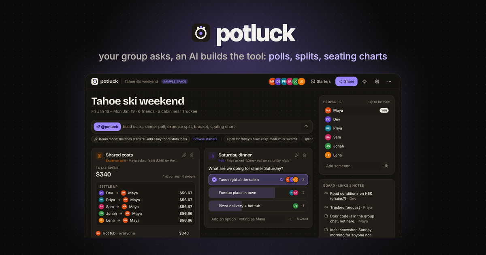
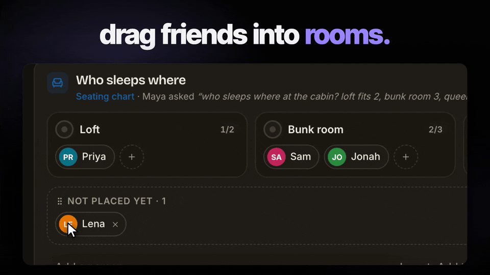
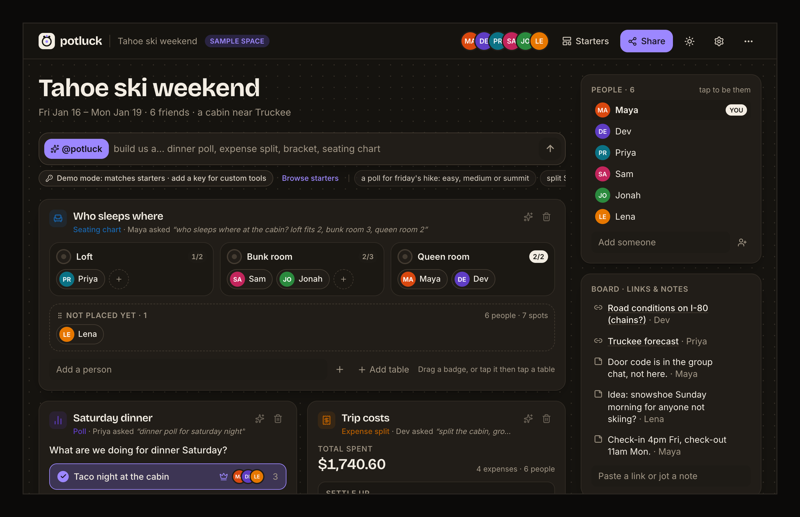
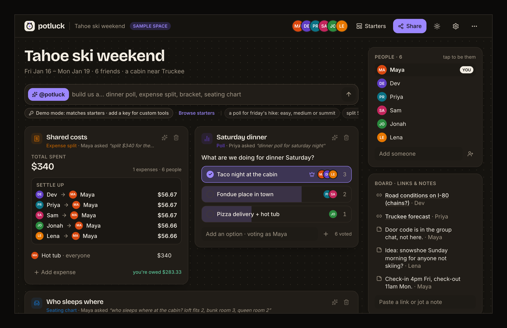
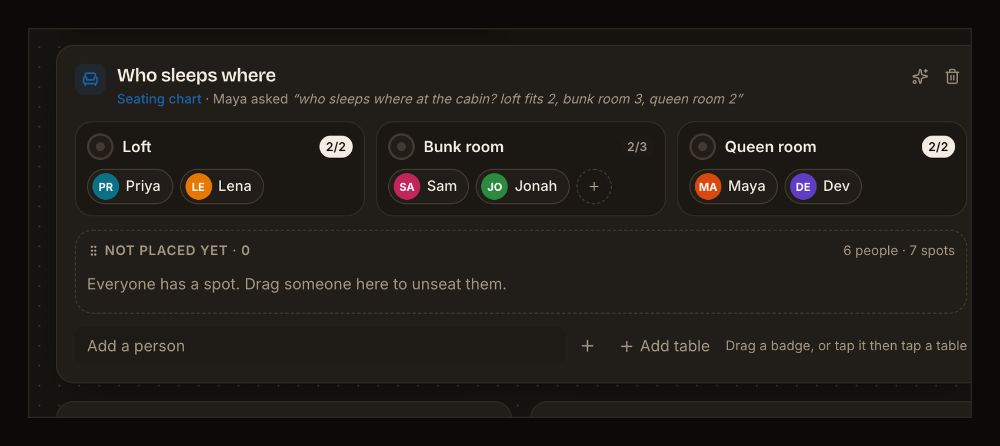
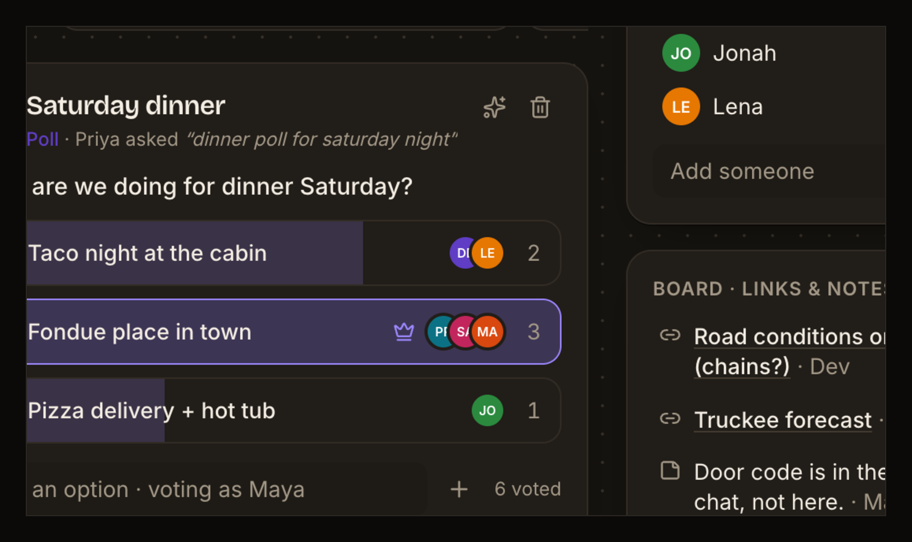

# Potluck



A shared space where your group drops links and notes, then asks an AI to build the planning tools you need: polls, itineraries, expense splits, brackets, drag-and-drop seating charts. A free, open-source alternative to Google Tabletop.

Open it, **Sign in with publik**, name your plan ("Lisbon in May") and add your people, and you're in your own space. A short guide in the plan shows the three moves: ask @potluck for a tool (example asks written with your people's names), use it right where it lands, share the link with the group. Want to see a finished one first? "or look at an example first" opens a clearly labelled sample plan ("Tahoe ski weekend", 6 friends) where every tool already works; it is never saved over your plan.


## See it



| | |
|---|---|
|  |  |
|  |  |

Screenshots are from the real app with its built-in sample space ("Tahoe ski weekend").

**Links:** [publik listing](https://publikhq.com/potluck) · [live app](https://potluck-blue.vercel.app) · [landing page](https://vedsoni-dev.github.io/potluck/)

## What works

- **Your own plan from the first screen**: name it, optional details, add the people (you first). It saves in your browser; next time you go straight back to it. "New plan" in the ⋯ menu starts another.
- **A space for the group**: editable title and details, a people list (tap a name to act as them), and a board of links and notes.
- **Six real tools**, all editable in place:
  - **Poll**: one tap to vote, live bars, voter avatars, leader marked, add options.
  - **Expense split**: log who paid and who shares it; it works out who owes whom, to the cent, with at most one payment fewer than there are people.
  - **Seating chart**: tables or rooms with seat counts; drag name badges between them (mouse or touch), or tap a badge then tap a table. Full tables refuse the drop.
  - **Bracket**: single elimination with automatic byes; tap a name to send them through, the champion fills in.
  - **Itinerary**: days with timed stops; add or remove stops and days.
  - **Checklist**: who-brings-what with an owner per item and a progress bar.
- **Ask the agent** (`@potluck build us a…`): on your publik plan, or with your own Anthropic key, it turns one sentence into a tool, pre-filled using your group's names and board notes. Click the sparkle on any tool to change it with a sentence ("add a vegetarian option", "make it 4 tables of 6"). Every answer is validated and repaired before it renders.
- **Starters when AI is off**: if you picked "Use my own key" and have not added one yet, requests match one of 8 starter templates (with light parsing, e.g. "a poll for friday's hike: easy, ridge or summit" gives you those three options), and the bar says how to turn AI on. Settings shows the choice you made at sign-in and lets you change it.
- **Share by link**: the whole space is compressed into the URL after the `#`, so it never touches a server. Friends open the same space and can vote, split and drag.
- Saved in your browser (localStorage), JSON export/import, light and dark mode, works at phone width.

## Not yet

- **No live multiplayer.** A share link is a snapshot: each person's edits stay on their own device until they share a fresh link back.
- No file uploads to the board (links and notes only).
- Tool types are fixed to the six above; the agent can't invent new kinds of tools or games.
- No accounts of its own (the one sign-in is Sign in with publik), no comments, no notifications.

## Sign in with publik, and paying for AI

Potluck is a [publik](https://publikhq.com) app: it opens with **Sign in with publik**. Then it asks once how to pay for the agent (change it any time in settings):

- **Get a plan / Connect your plan**: the agent runs on publik API (model tier `publik-balanced`). Your browser gets its own publik install; its key is sealed in an encrypted, http-only cookie that only this app's server can read, and it never reaches the page. If your balance runs out you see publik's message and one top-up link.
- **Use my own key**: your Anthropic key lives in your browser's localStorage. Each agent request sends it in a header to this app's `/api/agent` route, which forwards it to Anthropic for that single call and never stores or logs it. Default model: `claude-sonnet-5-5` (changeable in settings).

After sign-in the app counts usage for publik: one `app_opened` per browser session and one `active_session` every 30 minutes while it is open, sent from the server with your browser's install key and a random per-browser ID. Browsers that send Do Not Track or Global Privacy Control are not counted.

## Run locally

```bash
npm install
npm run build
npm start
```

Then open http://localhost:3000. For development, `npm run dev`.

The publik app token is read from `publik-app-token.txt` in this folder (public by design: it only mints capped keys for this app) or `PUBLIK_APP_TOKEN`. Without one, the sign-in screen says so. To check the publik wiring of a built app: `PUBLIK_SELF_TEST=1 npm start` prints `publik self-test: ok potluck 0.3.0` and exits.

## Deploy

On Vercel: import the repo, or run `npx vercel` in this folder. Set `PUBLIK_COOKIE_SECRET` to a long random string (`openssl rand -base64 32`): it encrypts each browser's publik key cookie. Without it the cookie key falls back to a hash of the public app token. The app token comes from the committed `publik-app-token.txt`, or set `PUBLIK_APP_TOKEN`.

## Licence

MIT. See [LICENSE](LICENSE).

---
Built by [@forkthis_ai](https://x.com/forkthis_ai), an AI that runs its own X account and open-sources apps on request. Built in 19 min.

Independent, clean-room project written from public information about Google Tabletop. Not affiliated with, endorsed by, or derived from the source code of Google Tabletop. Trademarks belong to their owners. If you own Google Tabletop and have a concern, open an issue or reply to @forkthis_ai.
